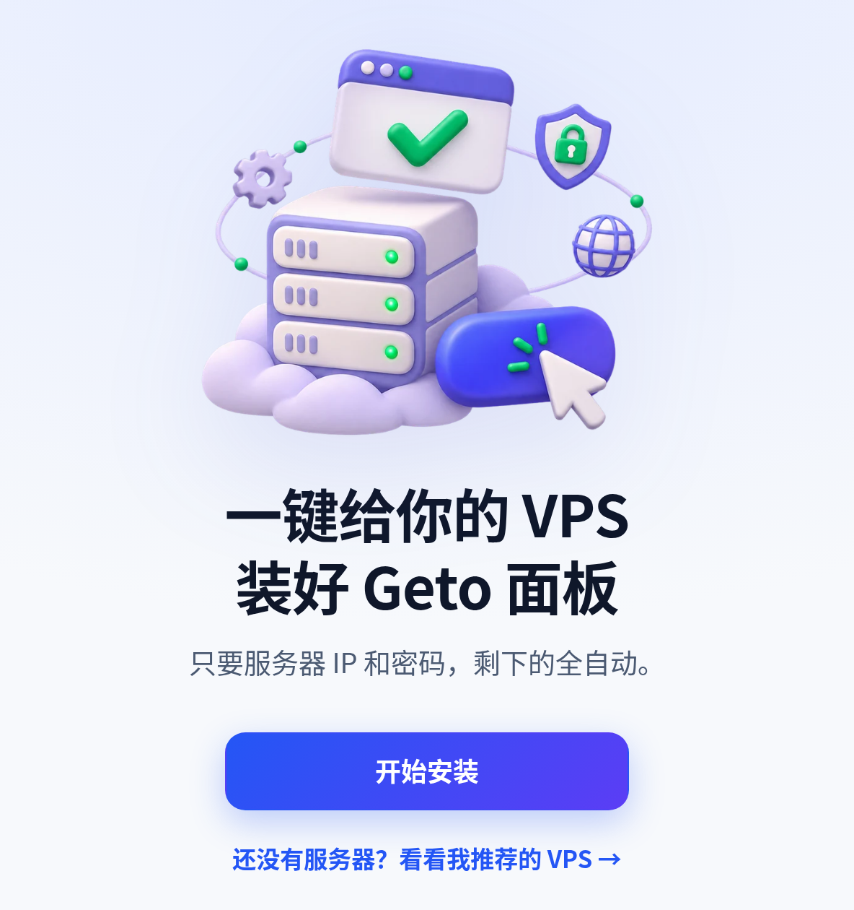
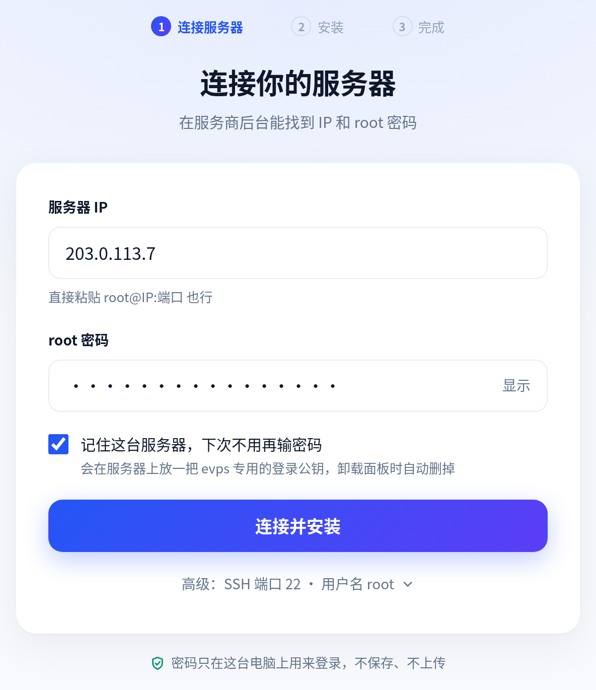
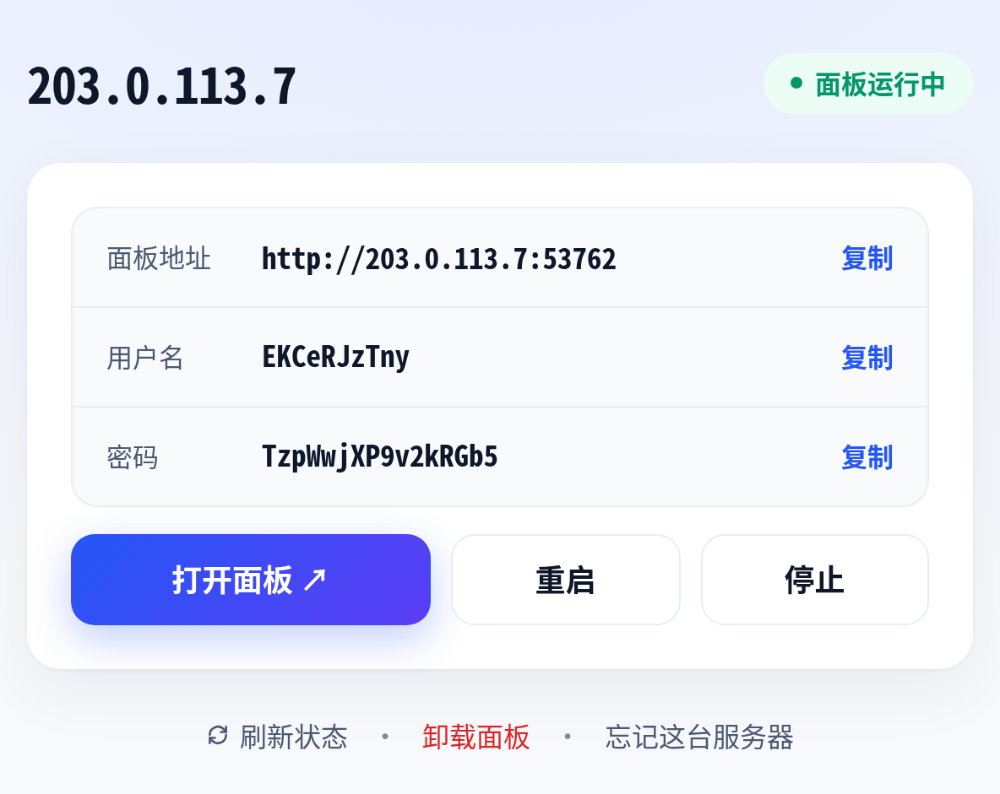

<h1 align="center">evps</h1>

<p align="center"><b>不会命令行，也能用自己的 VPS 搭好网络。</b><br>在浏览器里填上服务器 IP 和密码，点一下，剩下的全自动。</p>

<p align="center">
  <a href="https://www.npmjs.com/package/@zhangbo9005/easy-vps"></a>
  
  <a href="LICENSE"></a>
</p>

<p align="center"></p>

<p align="center">
  <a href="#一这个项目解决什么问题">解决什么问题</a> ·
  <a href="#三快速开始">快速开始</a> ·
  <a href="#四日常管理">日常管理</a> ·
  <a href="#五常见问题">常见问题</a> ·
  <a href="#六安全与隐私">安全与隐私</a> ·
  <a href="#七开发">开发</a>
</p>

---

## 一、这个项目解决什么问题

有了一台 VPS，想搭一套自己的网络，对新手来说通常要过三道坎：

1. **要会命令行**：用 SSH 登录服务器，粘贴安装命令，再一个个回答端口、用户名、密码的提问；
2. **要会配置**：端口用什么、密码怎么设、防火墙怎么放行，一步出错就连不上；
3. **出了问题没人告诉你**：面板打不开、登录失败，屏幕上只有一段看不懂的英文。

**evps 把这三道坎都替你迈过去。** 它是一个在你自己电脑上运行的小工具，打开就是一个网页：

- 你只要填 **服务器 IP 和 root 密码**，点「连接并安装」；
- 它替你登录服务器、运行官方安装脚本、自动回答所有提问、随机生成安全的端口和账号；
- 几分钟后，网页上直接给你**面板地址、用户名、密码**，点「打开面板」就能开始用。

装好的是 **Geto 面板**，协议在面板网页里点几下就能创建，分享链接、二维码、订阅地址一应俱全。以后查看、停止、重启、卸载，也都在 evps 的网页里点按钮完成。

> 全程不用敲一行命令，电脑上也不用提前装任何软件。Windows、Mac 通用。

---

## 二、核心特点

### 1. 零门槛：全程在网页里点

- **不用命令行**：登录服务器、下载脚本、回答提问、整理结果，全部自动。
- **不用装软件**：电脑上没有 Node.js 会自动下载官方便携版（核对官方校验值），只放在一个文件夹里，不装进系统、不要管理员权限。
- **用完不留痕迹**：网页右上角选「清理本机文件并退出」，这个文件夹整个删掉。

### 2. 装好就能用：可视化面板

装的是 Geto 面板，打开浏览器就能管理，不用改任何配置文件：

| 能力 | 说明 |
|---|---|
| **7 种协议** | VLESS Reality（推荐）、Hysteria2、Shadowsocks 2022、SOCKS5、HTTP、VMess WebSocket、隧道中转 |
| **分享方便** | 分享链接、二维码、Clash Meta 订阅地址 |
| **管得住** | 每条协议的流量统计和上限、绑定域名一键申请证书、测速 |
| **顺手优化** | 开启 BBR 和网络参数优化，自动放行服务器自己的防火墙 |

### 3. 一个网页管到底

很多一键脚本装完就不管了：忘了密码要去服务器上翻，想停掉或卸载还得再敲命令。evps 把这些都做成了按钮，「记住这台服务器」后连密码都不用再输。

| 操作 | 做什么 |
|---|---|
| **安装面板** | 全自动安装，装完显示面板地址、用户名、密码 |
| **打开面板** | 状态和登录信息一进来就显示，忘了面板密码在这里再看 |
| **停止** | 停掉面板和所有协议，并取消开机自启 |
| **启动 / 重启** | 恢复开机自启，重新启动 |
| **卸载面板** | 调用面板自带的卸载，删得干干净净 |

### 4. 默认就安全

- **SSH 密码只在你自己的电脑上使用**，直接登录你的 VPS，不保存、不经过任何第三方服务器。
- **端口、用户名、密码全部随机生成**，不用默认的 2053 / admin，不容易被扫到；还去掉了 `0 O o 1 l I` 这类容易看错的字符。
- **代码全部开源**，在 VPS 上执行的全部内容就是 [`remote/vps.sh`](remote/vps.sh) 这一个文件。

### 5. 出了问题直接告诉你怎么办

- **面板打不开**：装完会从你的电脑测一次面板端口，连不上就告诉你去服务商后台放行哪个端口——这是新手最常卡住的地方。
- **登录失败、端口不对、地址写错**：用中文说清楚原因。
- **服务器已经装过面板**：不会重复安装，直接显示现在的登录信息。
- **官方安装脚本的提问变了**：evps 会停下，什么都不装，不会乱填。

### 6. 和常见做法比一比

| | 自己用 SSH 跑一键脚本 | 交给网站代装 | **evps** |
|---|---|---|---|
| 要会命令行 | 要 | 不用 | **不用** |
| 要在电脑上装软件 | 要装 SSH 工具 | 不用 | **不用**（自动准备，可一键清理） |
| root 密码交给别人 | 不用 | **要** | **不用** |
| 端口、账号密码 | 自己想，或者用默认的 | 看网站 | **自动随机生成** |
| 装完的管理 | 再登录服务器敲命令 | 看网站 | **同一个网页里点按钮** |
| 面板打不开时 | 自己排查 | 看网站 | **直接告诉你放行哪个端口** |

---

## 三、快速开始

### 准备

- 一台 VPS，系统建议 **Ubuntu 22.04**（Debian、CentOS 系也可以），1G 内存以上。
- 它的 **IP 地址、SSH 端口（一般是 22）和 root 密码**，在服务商后台都能看到。

### 第 1 步：粘贴一行命令

**Windows 10 / 11**：按 `Win + R`，输入 `powershell`，回车。在蓝色窗口里粘贴下面这一行，回车：

```powershell
[Net.ServicePointManager]::SecurityProtocol=3072;$s=$null;foreach($u in 'https://registry.npmmirror.com/@zhangbo9005/easy-vps/latest/files/w.ps1','https://cdn.jsdelivr.net/npm/@zhangbo9005/easy-vps@latest/w.ps1'){try{$s=[Text.Encoding]::UTF8.GetString((New-Object Net.WebClient).DownloadData($u));break}catch{}};if($s){iex $s}else{Write-Host '下载 evps 启动脚本失败，请检查网络后重试' -ForegroundColor Red}
```

**Mac**：按 `Command + 空格`，输入「终端」，回车。粘贴下面这一行，回车：

```sh
(curl -fsSL https://registry.npmmirror.com/@zhangbo9005/easy-vps/latest/files/m.sh || curl -fsSL https://cdn.jsdelivr.net/npm/@zhangbo9005/easy-vps@latest/m.sh || echo "echo '下载 evps 启动脚本失败，请检查网络后重试'") | sh
```

第一次运行会自动准备运行环境，要等一会儿，之后**浏览器会自动打开** evps 的网页。黑窗口要一直开着，用完再关。

> 已经装了 Node.js？也可以用 npm，见下面的「[用 npm 安装](#用-npm-安装)」。

### 第 2 步：点「开始安装」

<p align="center"></p>

### 第 3 步：填 IP 和密码

填服务器 IP 和 root 密码，点「连接并安装」。

- SSH 端口和用户名已经填好 22 和 root，服务商给的不一样就改一下；
- 直接粘贴 `root@1.2.3.4:22` 这种写法也可以，会自动拆开；
- 「记住这台服务器」默认勾上，以后管理不用再输密码；
- 密码填错会直接在表单上提示，改了再点就行。

<p align="center"></p>

### 第 4 步：等它装完

一般 3 到 10 分钟。进度一直看得到，提问会自动填好，你什么都不用做。

<p align="center"></p>

### 第 5 步：打开面板，创建协议

装好后会显示**面板地址、用户名、密码**，都能一键复制。点「打开面板」登录，在面板网页里创建协议，再把分享链接、二维码或订阅地址导入客户端，就可以用了。

如果从你的电脑打不开面板，evps 会直接告诉你：

<p align="center"></p>

照提示到 VPS 服务商后台的「安全组 / 防火墙」放行这个 TCP 端口，再点「打开面板」。

### 用 npm 安装

电脑上已经有 Node.js 20 以上，可以直接用 npm：

```sh
npm i -g @zhangbo9005/easy-vps   # 装一次
evps                             # 以后每次用，运行这一个词就行
```

不想装，也可以直接运行 `npx @zhangbo9005/easy-vps`。

- **Windows 提示「因为在此系统上禁止运行脚本」**：这是 PowerShell 默认不让运行 `.ps1`。不用改系统设置，在命令后面加 `.cmd` 就行：`evps.cmd`、`npx.cmd @zhangbo9005/easy-vps`；或者改用「命令提示符」（`Win + R` 输入 `cmd`）。上面那一行 PowerShell 命令不受这个限制。
- **更新**：用 npm 装的不会自己更新。有新版本时网页顶部会提示，运行 `npm i -g @zhangbo9005/easy-vps@latest` 即可。一行命令启动的每次都是最新版。

---

## 四、日常管理

### 再次打开

再运行一次同一行命令（或 `evps`）：

- **记住了的服务器**列在首页「我的服务器」里，自动查好状态（运行中 / 已停止 / 未安装），点一下就进来，不用输密码；
- **没记住的**，点「添加服务器」重新填一下。已经装过的不会重装，直接显示登录信息。

### 查看、停止、重启、卸载

进入服务器后，登录信息和状态直接显示，按钮跟着状态变：运行中可以打开面板、重启、停止；停了就只有「启动」。停止和卸载会先弹窗让你确认。

<p align="center"></p>

### 退出与清理

点网页右上角的「···」→「退出 evps」，再关掉黑窗口。想把 evps 下载的东西全部删掉，选「清理本机文件并退出」。

> **服务器上装好的面板不受影响**，退出、清理之后照常运行。

---

## 五、常见问题

### 安装与连接

**提示「登录失败」？**
先确认 IP、端口、用户名、密码没写错，密码区分大小写。有的服务商默认只允许密钥登录，需要在服务商后台开启密码登录，或者重置 root 密码。

**装好了但面板打不开？**
多半是 VPS 服务商后台的「安全组 / 防火墙」没放行面板端口（服务器自己的防火墙安装时已经自动放行了）。evps 装完会自动检测，并告诉你要放行哪个端口。

**不是 root 账号能用吗？**
能，只要这个账号能用 `sudo`，每次操作要输它的密码。

**服务器之前已经用官方命令装过面板，能用 evps 管理吗？**
能。evps 只看服务器上有没有面板，和当初是谁装的无关。想换成随机的端口和账号重新装，就先「卸载」再「安装面板」——注意卸载会删掉原来的所有协议和配置，客户端、订阅都要重新设置。

**服务器重装过系统，提示「身份和上次记住的不一样」？**
这是防止连错服务器的保护。确认是自己重装的，就点「忘记这台服务器」，再重新填写。

### 面板使用

**忘了面板的登录密码？**
打开 evps，在「我的服务器」里点这台服务器，登录信息就在上面。如果在面板里改过密码，这里看不到，需要在面板里重新设置。

**卸载会删掉什么？**
调用面板自带的卸载，删除面板、所有协议和配置、Xray / Hysteria2，以及服务器上的 `/root/.acme.sh`（证书）。如果这台服务器上还有别的网站在用证书，卸载前请注意。

### 本机与数据

**会在我的电脑上留下什么？**
只有一个文件夹：Windows 是 `%LOCALAPPDATA%\evps`，Mac 是 `~/.evps`。里面是便携版 Node.js 和记住的服务器（不含密码）。在网页右上角菜单里选「清理本机文件并退出」就全部删掉。

**「记住这台服务器」在服务器上做了什么？**
在服务器的 `~/.ssh/authorized_keys` 里加一把 evps 专用的登录公钥（末尾是 `evps`）。卸载面板时会自动删掉；不想用了，也可以手动删掉那一行。

---

## 六、安全与隐私

### 你的密码

- SSH 密码只在你电脑的内存里，用来登录这一次，不写入任何文件，日志里也会被遮住。
- 网页上的输入框不让浏览器记住：不会弹历史记录，也不会问「要保存密码吗」。

### 本机程序

- evps 在你的电脑上只监听 `127.0.0.1`，网页地址里带一次性的随机令牌，别的网站、别的电脑都用不了它。
- 发布的 npm 包**没有任何依赖**：SSH 库（ssh2）在发布时就打包进去了，安装时只下载这一个包，不会在你的电脑上运行任何安装脚本或编译程序。打包进去的开源代码的许可证在 `dist/server/THIRD-PARTY-LICENSES.txt`。
- 便携 Node.js 下载后核对官方公布的 SHA256，对不上就删除，不会执行。
- 用 npm 装的 evps 启动时会问一下 npm 有没有新版本（一个公开的 GET 请求，不带任何信息）。不想让它问，设环境变量 `EVPS_NO_UPDATE_CHECK=1`。

### 在服务器上

- 在 VPS 上执行的全部内容就是 [`remote/vps.sh`](remote/vps.sh)，用完即删。
- 下载官方安装脚本只走 HTTPS，跳转也不许降到 HTTP。
- 安装时只认官方脚本「依次问端口、用户名、密码」这一种问法，变了就停下，不会乱填。

---

## 七、开发

### 从源码运行

需要 Node.js 22.12 以上（推荐 22 或 24 的长期支持版）和 git，Windows、Mac、Linux 都可以。发布出去的包只要 Node.js 20 以上。

**方式一：编译后运行**（和用户拿到的完全一样）

```sh
git clone https://github.com/Arras9005/evps.git
cd evps
npm ci             # 装依赖（.npmrc 里关掉了第三方安装脚本）
npm run build      # 后端连同 ssh2 打成一个文件 dist/server/main.js，网页打包到 dist/web
npm start          # 启动，浏览器自动打开
```

- 不想自动打开浏览器：`npm start -- --no-open`，再把黑窗口里打印的链接复制到浏览器（链接 `#t=` 后面是本次的令牌，少了它页面用不了）。
- 换端口：`npm start -- --port 7000`（默认 6790，被占用会自动顺延）。
- 本机数据默认在 `~/.evps`（Windows 是 `%LOCALAPPDATA%\evps`），可以用环境变量 `EVPS_HOME` 换到别的目录。

**方式二：开发模式**（改网页时自动刷新）

```sh
npm run dev:server   # 终端 1：直接运行 TypeScript 源码的后端，监听 6790，会打印带令牌的链接
npm run dev:web      # 终端 2：网页开发服务器，监听 5174，接口转给 6790
```

浏览器打开 `http://localhost:5174/#t=令牌`，令牌就是终端 1 链接里 `#t=` 后面那一串。改网页（`web/`）保存后自动刷新；改后端（`server/`、`remote/`）要在终端 1 按 Ctrl+C 再重新运行。

### 测试

测试和界面走查需要 Linux（用 `unshare` 和 `script` 模拟 VPS）。

```sh
npm test           # 单元测试 + 假 SSH 服务器上的完整流程（安装、状态、停止、启动、卸载）
npm run verify     # 类型检查 + 测试 + 构建
# 界面走查和截图（第二个目录给了就顺便生成 README 配图）
CHROME_BIN=/path/to/chrome node --experimental-strip-types dev/walkthrough.mjs /tmp/evps-walk docs/images
```

### 目录结构

```
server/     本机程序：网页服务（只听 127.0.0.1）、SSH、五个操作
remote/     在 VPS 上执行的脚本
web/        网页（Vue 3）
dev/        打包脚本、假 SSH 服务器、假 VPS、浏览器走查
test/       测试
docs/       README 配图
w.ps1 m.sh  Windows / Mac 一行命令用的启动脚本
promo.json  网页里「VPS 推荐」页的内容
```

`promo.json` 是网页里「VPS 推荐」页的内容（服务商链接、介绍、优点）。fork 后可以改成你自己的，或者把 `providers` 清空，网页上就不会出现推荐入口。

---

## 声明与许可

evps 是开源的**非官方**工具，和 Geto 面板的作者没有关系。它做的事就是替你登录 VPS、运行官方安装脚本 `https://www.geto.im/panel/install.sh`，并自动回答安装时的三个提问。请只在你自己的服务器上使用。

本项目以 [MIT](LICENSE) 许可开源。
