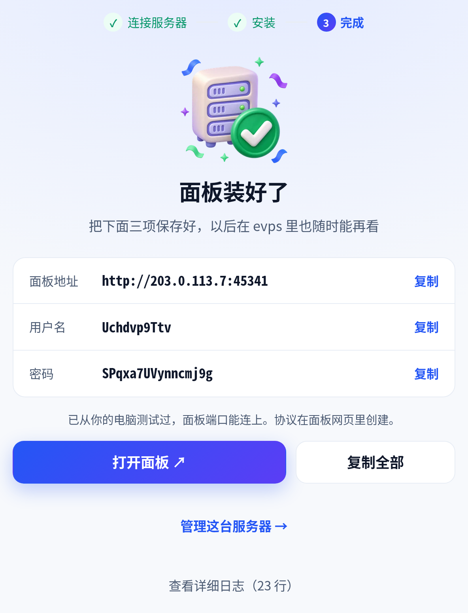
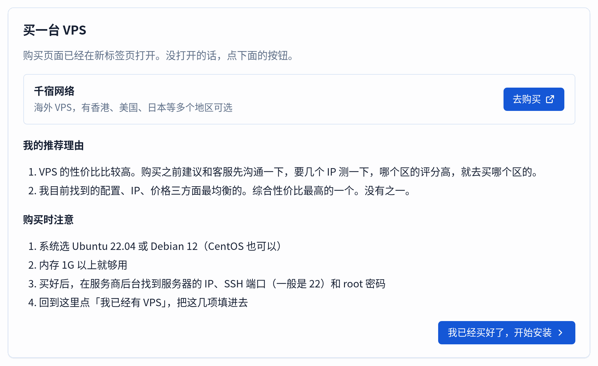
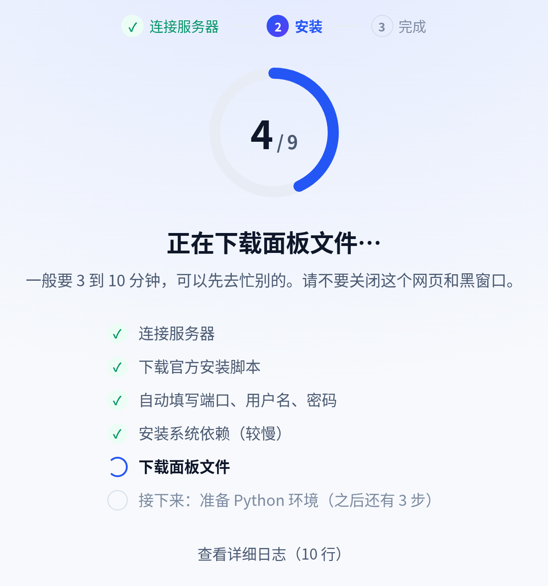
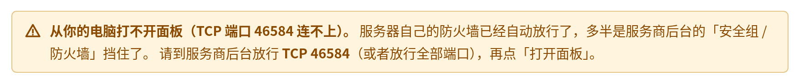

# evps

**在浏览器里，点几下就给你的 VPS 装好 Geto 面板；装好以后，查看、停止、重启、卸载也都在同一个网页里点。**

不用学 Linux 命令，不用在服务器上回答一串提问，不用记端口和密码。Windows、Mac 通用。

<p align="center"></p>

> 当前状态：测试阶段，还没有发布到 npm。下面的一行命令要等发布之后才能用。

---

## 为什么用 evps

### 1. 全程在网页里点，不用敲命令

常见的安装方式是：自己用 SSH 登录服务器，粘贴安装命令，再逐个回答端口、用户名、密码，装完把屏幕上的信息抄下来。
用 evps，你只需要在网页里填上**服务器 IP 和密码**，点「安装面板」，剩下的全自动：登录服务器、下载官方安装脚本、自动回答所有提问、等它装完、把结果整理好给你。

### 2. 装好就是一个可视化面板，协议在网页里点选创建

装的是 Geto 面板，打开浏览器就能管理，不用改任何配置文件：

- **7 种协议**：VLESS Reality（面板推荐）、Hysteria2、Shadowsocks 2022、SOCKS5、HTTP、VMess WebSocket、隧道中转
- **分享方便**：分享链接、二维码、Clash Meta 订阅地址
- **管得住**：每条协议的流量统计和流量上限、绑定域名一键申请证书、测速
- **装的时候顺手优化好**：开启 BBR 和网络参数优化，自动放行服务器自己的防火墙

### 3. 一个网页管到底：查看、停止、重启、卸载

很多一键脚本装完就不管了：登录密码忘了要去服务器上翻，想停掉或卸载还得再登录服务器敲命令。
evps 把这些都做成了按钮。勾选「记住这台服务器」以后，连密码都不用再输。

| 按钮 | 做什么 |
|---|---|
| **安装面板** | 全自动安装，装完显示面板地址、用户名、密码 |
| **查看状态 / 登录信息** | 面板和各服务是否在运行；忘了面板密码，点这里就能再看到 |
| **停止** | 停掉面板和所有协议，并取消开机自启 |
| **启动 / 重启** | 恢复开机自启，重新启动 |
| **卸载** | 调用面板自带的卸载，删得干干净净 |

### 4. 默认就更安全

- **端口、用户名、密码全部随机生成**，不用官方的默认值（端口 2053、用户名 admin），不容易被扫到。生成时去掉了 `0 O o 1 l I` 这类容易看错的字符，方便照着屏幕输入。
- **SSH 密码只在你自己的电脑上使用**，直接用来登录你的 VPS，不保存、不经过任何第三方服务器。有些「网站代装」需要你把 root 密码交给它们的服务器，evps 不需要。
- 代码全部开源，在 VPS 上执行的全部内容就是 [`remote/vps.sh`](remote/vps.sh) 这一个文件。

### 5. 出了问题直接告诉你怎么办

- **面板打不开**：装完会从你的电脑测一次面板端口。连不上就直接告诉你去服务商后台的「安全组」放行哪个端口，这是新手最常卡住的地方。
- **登录失败、端口不对、地址写错**：用中文说清楚原因，不会只甩给你一段英文报错。
- **服务器已经装过面板**：不会重复安装，会把现在的登录信息直接显示出来。
- **官方安装脚本的提问变了**：evps 会停下，什么都不装，不会乱填。

### 6. 电脑上什么都不用装，用完一键清理

不需要提前安装任何软件。电脑上没有 Node.js，会自动下载官方的便携版（核对官方公布的校验值），只放在一个文件夹里，不装进系统、不要管理员权限。用完点「清理本机文件」，这个文件夹整个删掉，电脑上不留东西。

### 和常见做法比一比

| | 自己用 SSH 跑一键脚本 | 交给网站代装 | **evps** |
|---|---|---|---|
| 要会命令行 | 要 | 不用 | **不用** |
| 要在电脑上装软件 | 要装 SSH 工具 | 不用 | **不用**（自动准备，可一键清理） |
| root 密码交给别人 | 不用 | **要** | **不用** |
| 端口、账号密码 | 自己想，或者用默认的 | 看网站 | **自动随机生成** |
| 装完的管理 | 再登录服务器敲命令 | 看网站 | **同一个网页里点按钮** |
| 面板打不开时 | 自己排查 | 看网站 | **直接告诉你放行哪个端口** |

---

## 怎么用

### 准备

- 一台 VPS，系统是 **Ubuntu、Debian 或 CentOS 系**都可以，建议 1G 内存以上。
- 它的 **IP 地址、SSH 端口（一般是 22）和 root 密码**，在服务商后台都能看到。
- 还没有 VPS？打开 evps 后点首页的「我还没有 VPS」，有购买指引。

### 第一步：打开黑窗口，粘贴一行命令

**Windows 10 / 11**：按键盘上的 `Win + R`，输入 `powershell`，回车。在打开的蓝色窗口里粘贴下面这一行，回车：

```powershell
[Net.ServicePointManager]::SecurityProtocol=3072;$s=$null;foreach($u in 'https://registry.npmmirror.com/@zhangbo9005/easy-vps/latest/files/w.ps1','https://cdn.jsdelivr.net/npm/@zhangbo9005/easy-vps@latest/w.ps1'){try{$s=[Text.Encoding]::UTF8.GetString((New-Object Net.WebClient).DownloadData($u));break}catch{}};if($s){iex $s}else{Write-Host '下载 evps 启动脚本失败，请检查网络后重试' -ForegroundColor Red}
```

**Mac**：按 `Command + 空格`，输入「终端」，回车。粘贴下面这一行，回车：

```sh
(curl -fsSL https://registry.npmmirror.com/@zhangbo9005/easy-vps/latest/files/m.sh || curl -fsSL https://cdn.jsdelivr.net/npm/@zhangbo9005/easy-vps@latest/m.sh || echo "echo '下载 evps 启动脚本失败，请检查网络后重试'") | sh
```

第一次运行会自动准备运行环境，要等一会儿。之后**浏览器会自动打开** evps 的网页。黑窗口要一直开着，用完再关。

> 电脑上已经装了 Node.js 18 以上，也可以直接运行 `npx @zhangbo9005/easy-vps`。

### 第二步：点「我已经有 VPS」

<p align="center"></p>

还没有 VPS 的话点右边，会打开购买页面并告诉你买的时候选什么：

<p align="center"></p>

### 第三步：填服务器信息，点「安装面板」

填上 IP、SSH 端口、用户名（一般是 root）和密码。直接粘贴 `root@1.2.3.4:22` 这种写法也可以，会自动拆开。

想以后管理时不用再输密码，就勾上「记住这台服务器」。

<p align="center"></p>

### 第四步：等它装完（一般 3 到 10 分钟）

每一步的进度都看得到，提问会自动填好，你什么都不用做。

<p align="center"></p>

### 第五步：打开面板，创建协议

装好后会显示**面板地址、用户名、密码**，都能一键复制，点「打开面板」就能登录。登录后在面板网页里创建协议，扫码或复制分享链接、订阅地址到客户端即可。

如果从你的电脑打不开面板，evps 会直接告诉你：

<p align="center"></p>

照提示到 VPS 服务商后台的「安全组 / 防火墙」放行这个 TCP 端口，再点「打开面板」。

### 以后：查看、停止、重启、卸载

再运行一次同一行命令，打开 evps：
- 勾选过「记住这台服务器」的，首页「记住的服务器」里点一下就进来，不用输密码；
- 没勾选的，点「我已经有 VPS」，重新填一下。

然后点对应的按钮。停止和卸载会先弹窗让你确认。

<p align="center"></p>

### 用完

网页底部点「退出」，然后关掉黑窗口。想把 evps 下载的东西全部删掉，点「清理本机文件」。**服务器上装好的面板不受影响**，照常运行。

---

## 常见问题

**装好了但面板打不开？**
多半是 VPS 服务商后台的「安全组 / 防火墙」没放行面板端口，服务器自己的防火墙安装时已经自动放行了。evps 装完会自动检测，并告诉你要放行哪个端口。

**提示「登录失败」？**
先确认 IP、端口、用户名、密码没写错，密码区分大小写。有的服务商默认只允许密钥登录，需要在服务商后台开启密码登录，或者重置 root 密码。

**忘了面板的登录密码？**
打开 evps，对这台服务器点「查看状态 / 登录信息」。如果在面板里改过密码，这里看不到，需要在面板里重新设置。

**服务器之前已经用官方命令装过面板，能用 evps 管理吗？**
能。evps 看的是服务器上有没有面板，和当初是谁装的无关，查看、停止、重启、卸载都能用。想换成随机的端口和账号重新装，就先「卸载」再「安装面板」。注意卸载会删掉原来的所有协议和配置，客户端、订阅都要重新设置。

**卸载会删掉什么？**
调用面板自带的卸载，删除面板、所有协议和配置、Xray / Hysteria2，以及服务器上的 `/root/.acme.sh`（证书）。如果这台服务器上还有别的网站在用证书，卸载前请注意。

**不是 root 账号能用吗？**
能，只要这个账号能用 `sudo`，每次操作要输它的密码。

**服务器重装过系统，提示「身份和上次记住的不一样」？**
这是防止连错服务器的保护。确认是自己重装的，就点「忘记这台服务器」，再重新填写。

**会在我的电脑上留下什么？**
只有一个文件夹：Windows 是 `%LOCALAPPDATA%\evps`，Mac 是 `~/.evps`。里面是便携版 Node.js 和记住的服务器（不含密码）。点「清理本机文件」就全部删掉。

**「记住这台服务器」在服务器上做了什么？**
在服务器的 `~/.ssh/authorized_keys` 里加一把 evps 专用的登录公钥（末尾是 `evps`）。卸载面板时会自动删掉；不想用了，也可以手动删掉那一行。

---

## 安全说明

- evps 在你的电脑上只监听 `127.0.0.1`，网页地址里带一次性的随机令牌，别的网站、别的电脑都用不了它。
- SSH 密码只在内存里，用来登录这一次，不写入任何文件，日志里也会被遮住。
- 安装时只认官方脚本「依次问端口、用户名、密码」这一种问法，变了就停下。
- 便携 Node.js 下载后核对官方公布的 SHA256，对不上就删除，不会执行。

## 关于购买推荐

首页的「我还没有 VPS」会打开购买页。购买页写了作者的推荐理由，并给出一家 VPS 服务商的链接。不需要的话直接点「我已经有 VPS」。链接和推荐理由写在 [`promo.json`](promo.json) 里。

> evps 是开源的**非官方**工具，和 Geto 面板的作者没有关系。它做的事就是替你登录 VPS、运行官方安装脚本 `https://www.geto.im/panel/install.sh`，并自动回答安装时的三个提问。请只在你自己的服务器上使用。

---

## 从源码启动

需要 Node.js 22.12 以上（推荐 22 或 24 的长期支持版）和 git。Windows、Mac、Linux 都可以。

### 方式一：编译后运行（和用户拿到的完全一样）

```sh
git clone https://github.com/Arras9005/evps.git
cd evps
npm ci             # 装依赖（.npmrc 里关掉了第三方安装脚本）
npm run build      # 编译后端到 dist/server，打包网页到 dist/web
npm start          # 启动，浏览器自动打开
```

- 不想自动打开浏览器：`npm start -- --no-open`，再把黑窗口里打印的链接复制到浏览器（链接 `#t=` 后面是本次的令牌，少了它页面用不了）。
- 换端口：`npm start -- --port 7000`（默认 6790，被占用会自动顺延）。
- 本机数据默认在 `~/.evps`（Windows 是 `%LOCALAPPDATA%\evps`），可以用环境变量 `EVPS_HOME` 换到别的目录。

### 方式二：开发模式（改网页时自动刷新）

开两个终端：

```sh
npm run dev:server   # 终端 1：直接运行 TypeScript 源码的后端，监听 6790，会打印带令牌的链接
npm run dev:web      # 终端 2：网页开发服务器，监听 5174，接口转给 6790
```

浏览器打开 `http://localhost:5174/#t=令牌`，令牌就是终端 1 链接里 `#t=` 后面那一串。
改网页（`web/`）保存后自动刷新；改后端（`server/`、`remote/`）要在终端 1 按 Ctrl+C 再重新运行。
6790 被别的程序占着时，后端会换到 6791，网页开发服务器就连不上它，先把占用的程序关掉。

### 测试

测试和界面走查需要 Linux（用 `unshare` 和 `script` 模拟 VPS）。

```sh
npm test           # 单元测试 + 假 SSH 服务器上的完整流程（安装、状态、停止、启动、卸载）
npm run verify     # 类型检查 + 测试 + 构建，发布前会自动跑
# 界面走查和截图（第二个目录给了就顺便生成 README 配图）
CHROME_BIN=/path/to/chrome node --experimental-strip-types dev/walkthrough.mjs /tmp/evps-walk docs/images
```

### 目录

```
server/     本机程序：网页服务（只听 127.0.0.1）、SSH、五个操作
remote/     在 VPS 上执行的脚本
web/        网页（Vue 3）
dev/        假 SSH 服务器、假 VPS、浏览器走查
test/       测试
docs/       README 配图
w.ps1 m.sh  Windows / Mac 一行命令用的启动脚本
promo.json  首页的推荐链接
```

## 许可

[MIT](LICENSE)
